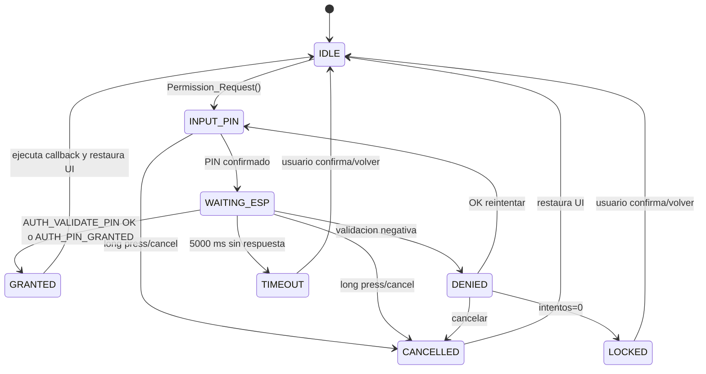

# Permission and granted flow

Este documento define como funciona el flujo de permisos entre Web, ESP, STM y Qt. La implementacion actual vive en `Core/Inc/permissions.h`, `Core/Src/permissions.c`, `Core/Src/uner_app.c`, `Core/Src/eventManagers.c` y `Core/Src/notificationWrappers.c`.

## Concepto de granted

`granted` significa que una accion protegida fue autorizada por un tiempo limitado. Internamente el STM guarda:

```c
authorizedUntil[permission] = HAL_GetTick() + ttl_ms;
```

Mientras `Permission_IsAuthorized(permission, now)` sea true, la accion puede ejecutarse sin volver a pedir PIN. No es estrictamente single-use; es multi-use hasta expirar. El TTL se resuelve asi:

| Caso | TTL usado |
|---|---:|
| respuesta externa trae `ttl_ms != 0` | ese TTL, limitado a 300000 ms |
| respuesta externa trae `ttl_ms == 0` | TTL de politica |
| politica TTL es 0 | default 30000 ms |

Timeouts actuales:

| Valor | Uso |
|---|---|
| `PERMISSION_REQUEST_TIMEOUT_MS = 5000` | espera maxima de validacion externa |
| `PERMISSION_DEFAULT_TTL_MS = 30000` | TTL default |
| `PERMISSION_RESPONSE_TTL_MAX_MS = 300000` | maximo TTL aceptado |

## Permisos definidos

| ID | Nombre | TTL politica | Intentos | Estado actual |
|---:|---|---:|---:|---|
| `0` | `PERMISSION_NONE` | 0 | 0 | no requiere validacion |
| `1` | `PERMISSION_ESP_RESET` | 30000 ms | 3 | usado por Reset ESP |
| `2` | `PERMISSION_FACTORY_RESET` | 15000 ms | 3 | reservado/listo |
| `3` | `PERMISSION_WIFI_CREDENTIALS` | 60000 ms | 3 | reservado/listo |
| `4` | `PERMISSION_MOTOR_TEST` | 30000 ms | 3 | reservado/listo |
| `5` | `PERMISSION_SYSTEM_CONFIG` | 60000 ms | 3 | reservado/listo |
| `6` | `PERMISSION_CAR_MODE_TEST` | 60000 ms | 3 | usado para entrar a TEST_MODE |

Acciones protegidas encontradas:

| Accion | Archivo | Permiso |
|---|---|---|
| Reset ESP | `Core/Src/notificationWrappers.c` | `PERMISSION_ESP_RESET` |
| Confirmar cambio a TEST_MODE | `Core/Src/eventManagers.c` | `PERMISSION_CAR_MODE_TEST` |

## Estados

| Estado | Significado | Pantalla |
|---|---|---|
| `AUTH_IDLE` | no hay validacion activa | pantalla normal |
| `AUTH_INPUT_PIN` | STM espera ingreso de PIN local/remoto | `SCREEN_CODE_WARNING_PIN_ENTRY` |
| `AUTH_WAITING_ESP` | PIN enviado al validador externo | `SCREEN_CODE_WARNING_PIN_WAITING` |
| `AUTH_GRANTED` | permiso concedido, se ejecuta continuacion | restaura pantalla previa |
| `AUTH_DENIED` | PIN incorrecto, puede reintentar | `SCREEN_CODE_WARNING_PIN_DENIED` |
| `AUTH_CANCELLED` | usuario cancelo | restaura pantalla previa |
| `AUTH_TIMEOUT` | no hubo respuesta externa en 5 s | `SCREEN_CODE_WARNING_PIN_TIMEOUT` |
| `AUTH_EXPIRED` | TTL expiro | evento interno |
| `AUTH_LOCKED` | sin intentos restantes | `SCREEN_CODE_WARNING_PIN_BLOCKED` |

Diagrama:



## Flujo local con PIN y validador externo

1. Usuario fisico o Web/Qt dispara una accion protegida.
2. El handler llama `Permission_Request(permission, continuation, ctx)`.
3. Si el permiso ya esta granted, se ejecuta `continuation(ctx)` inmediatamente.
4. Si no esta granted, STM guarda contexto UI, callback pendiente y entra en `AUTH_INPUT_PIN`.
5. STM reporta `EVT_SCREEN_CHANGED` con `SCREEN_CODE_WARNING_PIN_ENTRY`.
6. Usuario ingresa PIN con encoder/boton, o Web simula esos eventos.
7. Al confirmar, STM incrementa `requestId`, entra en `AUTH_WAITING_ESP` y envia `AUTH_VALIDATE_PIN (0x51)`.
8. ESP/Web responde con mismo CMD `0x51`.
9. STM llama `Permission_OnValidationResult()`.
10. Si es granted, guarda TTL, restaura UI y ejecuta la accion pendiente.
11. Si falla, muestra denied/locked/timeout.

`AUTH_VALIDATE_PIN (0x51)` request STM -> ESP:

| Byte | Campo |
|---:|---|
| 0 | request_id |
| 1 | permission |
| 2 | PIN digito 0 |
| 3 | PIN digito 1 |
| 4 | PIN digito 2 |
| 5 | PIN digito 3 |

Respuesta ESP/Web -> STM:

| Byte | Campo |
|---:|---|
| 0 | status, `0=OK` |
| 1 | request_id |
| 2 | permission |
| 3 | granted, `0/1` |
| 4..7 | ttl_ms LE opcional |
| 8 | attempts_left opcional, `0xFF` si no aplica |

## Flujo Web como actor activo

La Web puede operar de dos maneras.

Modo A, simular input real:

1. Web recibe `SCREEN_CODE_WARNING_PIN_ENTRY`.
2. Web renderiza PIN.
3. Web envia rotaciones y presses con `0x57`, `0x58`, `0x54` o `0x55`.
4. STM sigue su flujo normal y envia `0x51` al validador externo.
5. Web/ESP responde `0x51`.

Modo B, validacion externa directa:

1. Web recibe `SCREEN_CODE_WARNING_PIN_ENTRY` o `SCREEN_CODE_WARNING_PIN_WAITING`.
2. Web valida PIN o credencial fuera del STM.
3. Si concede, envia `AUTH_PIN_GRANTED (0x59)` con `[screen_code_le32]`.
4. STM verifica que el screen code coincida y que haya permiso pendiente.
5. STM ejecuta `Permission_GrantCurrentRequest(0)`.

Para denegacion, timeout o bloqueo remoto, Web envia `AUTH_REMOTE_RESULT (0x5D)`.

`AUTH_PIN_GRANTED (0x59)` request Web/Qt -> STM:

| Byte | Campo |
|---:|---|
| 0..3 | screen_code LE, debe ser `PIN_ENTRY` o `PIN_WAITING` actual |

Respuesta: `[status]`.

`AUTH_REMOTE_RESULT (0x5D)` request Web/Qt -> STM:

| Byte | Campo | Valores |
|---:|---|---|
| 0..3 | screen_code LE | debe coincidir con screen actual |
| 4 | result_code | `0=DENIED`, `1=TIMEOUT`, `2=BLOCKED` |
| 5 | attempts_left | intentos restantes |

Respuesta: `[status]`.

## Status de validacion remota

| Status | Significado |
|---:|---|
| `0` | OK |
| `1` | payload invalido |
| `2` | screen mismatch |
| `3` | el screen actual no requiere PIN |
| `4` | no hay permiso pendiente |
| `5` | argumento invalido |

## Seguridad y coherencia

1. Toda validacion remota debe incluir el `screen_code` actual. Esto evita conceder una accion vieja si la UI ya cambio.
2. Solo se ejecuta la accion guardada en el STM, no una accion enviada por texto desde Web.
3. Si hay un permiso pendiente, una segunda accion protegida emite `PERMISSION_EVT_BUSY` y no pisa la primera.
4. `PERMISSION_CAR_MODE_TEST` tiene tratamiento especial ante denegacion: restaura UI y muestra notificacion de permiso denegado.
5. Web/Qt debe considerar expirado el permiso cuando reciba cambios de pantalla/timeout o si la accion vuelve a pedir PIN.

## Compatibilidad con Web, ESP y Qt

El ESP no debe decidir la accion de negocio. Debe validar PIN/credencial y devolver resultado binario. La Web puede iniciar acciones remotas por control de UI; el STM decide si requieren permiso y que callback ejecutar.

Qt por USB usara el mismo contrato cuando `UNER_TR_USB_CDC` deje de ser stub. Hasta entonces, los comandos estan documentados pero no hay transporte USB funcional en runtime.

