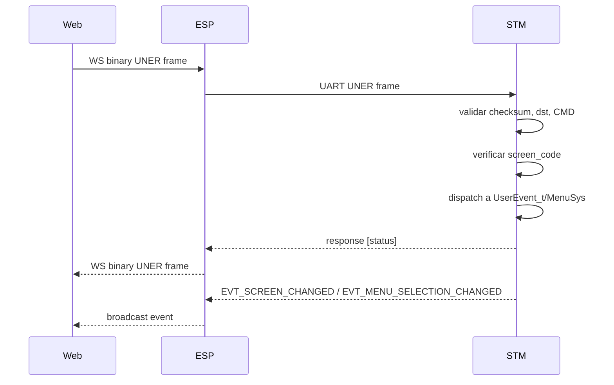

# Remote UI control: Web/Qt -> STM

Este documento define como Web y Qt controlan la UI del STM como si usaran el encoder y el boton fisico. La implementacion real esta en `Core/Src/uner_app.c`, `Core/Src/menusystem.c`, `Core/Src/ui_event_router.c`, `Core/Src/eventManagers.c` y `Core/Src/menu_definition.c`.

## Principio de diseno

La UI remota no duplica logica. Web/Qt envia eventos UNER, STM los convierte a `UserEvent_t` o a una seleccion de menu, y el mismo handler que usa el hardware procesa la accion.

Ruta:

```text
Web/Qt
  -> UNER command
  -> ESP bridge o USB
  -> STM UNER parser
  -> cmd_*_handler()
  -> menuSystem.userEventManagerFn(event) o MenuSys_HandleClick()
  -> pantalla/notificacion/eventos UNER de feedback
```

El ESP debe ser bridge: WebSocket <-> UART UNER. No debe interpretar permisos, menus ni acciones de negocio.

## Sincronizacion de pantalla

Antes de enviar input remoto, Web/Qt debe conocer el screen actual:

1. Escuchar `EVT_SCREEN_CHANGED (0x95)`.
2. Escuchar `EVT_MENU_SELECTION_CHANGED (0x96)` si es menu.
3. Si hay duda o reconexion, enviar `GET_CURRENT_SCREEN (0x52)`.

Todos los comandos de input incluyen `screen_code_le32`. El STM rechaza si no coincide con `MenuSys_GetCurrentScreenCode()`. Esto evita ejecutar acciones sobre una pantalla vieja.

## Eventos de usuario

`Core/Inc/types/userEvent_type.h` define:

| UserEvent_t | Uso fisico | Uso remoto |
|---|---|---|
| `UE_SHORT_PRESS` | boton usuario short | `TRIGGER_USER_BUTTON` short |
| `UE_LONG_PRESS` | boton usuario long | `TRIGGER_USER_BUTTON` long |
| `UE_ENC_SHORT_PRESS` | encoder press short | `TRIGGER_ENCODER_BUTTON` short |
| `UE_ENC_LONG_PRESS` | encoder press long | `TRIGGER_ENCODER_BUTTON` long |
| `UE_ROTATE_CW` | encoder horario | `TRIGGER_ENCODER_ROTATE_RIGHT` |
| `UE_ROTATE_CCW` | encoder antihorario | `TRIGGER_ENCODER_ROTATE_LEFT` |

## Comandos remotos

### `0x52 GET_CURRENT_SCREEN`

Direccion: Web/Qt -> STM.

Request: payload vacio.

Response:

| Byte | Campo |
|---:|---|
| 0..3 | screen_code LE |
| 4 | source |

Uso: recuperar sincronizacion al conectar o despues de perdida de frames.

### `0x56 REQUEST_SCREEN_PAGE`

Direccion: Web/Qt -> STM.

Request:

| Byte | Campo | Valores |
|---:|---|---|
| 0..3 | screen_code LE | debe coincidir con pantalla actual |
| 4 | direction | `0=UP`, `1=DOWN` |

El STM mueve el cursor `MENU_VISIBLE_ITEMS` veces. Sirve como page up/down de menu.

Response: `[status]`.

Errores reales: screen mismatch, no es menu actual, direccion invalida.

### `0x53 MENU_ITEM_CLICK`

Direccion: Web/Qt -> STM.

Request:

| Byte | Campo | Valores |
|---:|---|---|
| 0..3 | screen_code LE | debe coincidir con submenu actual |
| 4 | visible_item | item visible base uno, `1..MENU_VISIBLE_ITEMS` |

Flujo:

1. STM verifica screen actual.
2. STM verifica que sea menu actual.
3. Busca el item visible respetando `MenuSys_IsItemVisible()`.
4. Actualiza `currentItemIndex`.
5. Emite seleccion por `MenuSys_ReportCurrentMenuSelection()`.
6. Ejecuta `MenuSys_HandleClick()`.
7. Si el item esta protegido, entra a `Permission_Request()` y no duplica logica.

Response: `[status]`.

### `0x54 TRIGGER_ENCODER_BUTTON`

Direccion: Web/Qt -> STM.

Request:

| Byte | Campo | Valores |
|---:|---|---|
| 0..3 | screen_code LE | debe coincidir |
| 4 | press_kind | `0=short`, `1=long` |

Mapeo:

| press_kind | Evento |
|---:|---|
| `0` | `UE_ENC_SHORT_PRESS` |
| `1` | `UE_ENC_LONG_PRESS` |

Response: `[status]`.

### `0x55 TRIGGER_USER_BUTTON`

Direccion: Web/Qt -> STM.

Request:

| Byte | Campo | Valores |
|---:|---|---|
| 0..3 | screen_code LE | debe coincidir |
| 4 | press_kind | `0=short`, `1=long` |

Mapeo:

| press_kind | Evento |
|---:|---|
| `0` | `UE_SHORT_PRESS` |
| `1` | `UE_LONG_PRESS` |

Response: `[status]`.

### `0x57 TRIGGER_ENCODER_ROTATE_LEFT`

Direccion: Web/Qt -> STM.

Request:

| Byte | Campo |
|---:|---|
| 0..3 | screen_code LE |

Mapea a `UE_ROTATE_CCW`.

Response: `[status]`.

### `0x58 TRIGGER_ENCODER_ROTATE_RIGHT`

Direccion: Web/Qt -> STM.

Request:

| Byte | Campo |
|---:|---|
| 0..3 | screen_code LE |

Mapea a `UE_ROTATE_CW`.

Response: `[status]`.

## Flujo de navegacion Web



## Ejemplo: navegar menu y ejecutar item

1. Web recibe `SCREEN_CODE_CORE_MAIN_MENU`.
2. Web recibe seleccion actual por `0x96`.
3. Usuario toca "Sensores".
4. Web envia `MENU_ITEM_CLICK (0x53)` con payload `[0x01,0x02,0x01,0x00,0x02]` si el item visible 2 es Sensores.
5. STM cambia a `SCREEN_CODE_SENSORS_MENU`.
6. STM emite `EVT_SCREEN_CHANGED`.
7. Web renderiza menu Sensores.

Nota: los 4 bytes del screen code son little-endian. `0x00010201` se envia como `01 02 01 00`.

## Ejemplo: ejecutar accion protegida

1. Web envia `MENU_ITEM_CLICK` sobre "Reset ESP".
2. STM ejecuta el mismo click que el OLED.
3. `OledUtils_RenderESPResetMode_Wrapper()` llama `Permission_Request(PERMISSION_ESP_RESET, ...)`.
4. STM emite `SCREEN_CODE_WARNING_PIN_ENTRY`.
5. Web renderiza PIN.
6. Web puede simular input o conceder con `AUTH_PIN_GRANTED (0x59)`.
7. Si granted, STM ejecuta la continuacion guardada.
8. STM emite pantalla/notificacion resultante.

## MPU streaming remoto

Start:

```text
CMD 0x61
payload [01, period_l, period_h]
```

Stop:

```text
CMD 0x62
payload []
```

Respuesta start:

| Byte | Campo |
|---:|---|
| 0 | status |
| 1 | active |
| 2..3 | period_ms LE |
| 4 | transport_id |
| 5 | dst_node |

Despues del start OK, STM envia `EVT_APP_GET_MPU_READINGS (0x90)` al mismo `transport_id` y `src` que pidio el stream. Esto permite que Web y Qt no compitan por un broadcast ambiguo.

Regla importante:

| Build STM | Web por ESP | Qt por USB |
|---|---|---|
| UNER backend | permitido | contrato listo, USB stub |
| ESP_AT backend | no permitido por UART1 | contrato listo, USB stub |

## Integridad Web <-> ESP <-> STM

Checklist minimo:

1. Web debe enviar frames binarios, no JSON dentro del payload STM.
2. ESP debe reenviar bytes sin reinterpretar `CMD`.
3. Validar con `PING (0x31)` y `ECHO (0x42)`.
4. Verificar checksum XOR antes de culpar a UI.
5. Si STM no responde, Web debe pedir `GET_CURRENT_SCREEN (0x52)` despues de reconectar.
6. Para comandos remotos, usar siempre el ultimo screen code reportado.
7. Si llega status `2`, Web debe refrescar pantalla, no reintentar ciegamente.

## Casos no implementados todavia

| Area | Estado | Implementacion minima compatible |
|---|---|---|
| Qt por USB | contrato documentado, transporte USB CDC stub | implementar `try_send` y `poll_rx` en `uner_transport_usbcdc.c` usando CDC RX/TX |
| Web en build ESP_AT | no viable por UART1 porque UART1 habla comandos AT | usar USB CDC para Qt/Web local, o separar una segunda UART |
| Render Web de assets binarios | STM puede pedir chunks `0x5A`; Web/ESP debe servirlos | mantener payload chunk definido en `uner_app.h` |

